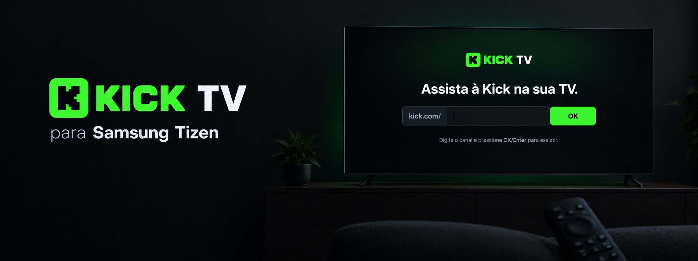
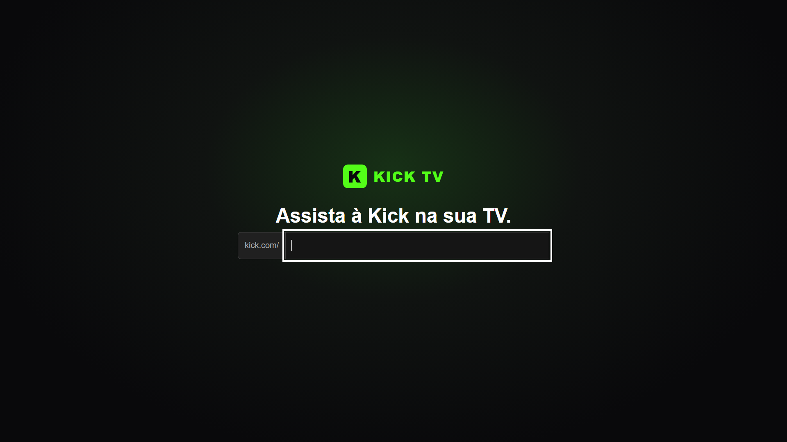

# Kick TV para Samsung Tizen

Protótipo Tizen para assistir a canais da Kick em uma Samsung Smart TV usando o player de vídeo nativo.

O projeto está em fase de validação técnica e **não é um aplicativo oficial da Kick**.

## Como funciona

- A tela inicial começa com o campo do canal vazio. Depois que você iniciar um canal, o nome fica salvo no armazenamento local daquele aparelho e reaparece nas próximas aberturas.
- Ao confirmar o canal, o app consulta `https://kick.com/api/v2/channels/{canal}/livestream` e procura o endereço HLS (`.m3u8`) retornado pela Kick.
- A transmissão é aberta em um elemento `<video>` nativo do Tizen, com tentativa de reprodução automática e áudio habilitado.
- A compatibilidade depende de o canal estar ao vivo, da resposta da API e do suporte do firmware da TV ao fluxo de vídeo e áudio recebido.

O endpoint consultado é interno e não constitui uma API oficial para integração de terceiros. Os [Termos de Serviço para desenvolvedores da Kick](https://dev.kick.com/terms-of-service) exigem o player incorporado para conteúdo de vídeo e autorização prévia por escrito para usar outro player. A reprodução nativa permanece experimental e não deve ser distribuída sem essa autorização.

## Controles

- O foco inicial fica no campo do canal. Digite o nome e pressione **OK/Enter** para iniciar a reprodução.
- Durante a reprodução, **RETURN/Back** volta à tela inicial.

## Projeto Tizen

A fonte do app está em [`kick/`](kick/):

- `index.html`: interface, consulta do canal, controles e reprodução de vídeo.
- `config.xml`: identidade do app, perfil Samsung TV, ícone e permissões de rede.
- `icon.png`: ícone instalado na TV.
- `.project` e `.tproject`: metadados de importação e plataforma do Tizen Studio.

O manifesto define o perfil `tv-samsung` e plataforma Tizen TV 10.0 no projeto. O app pode exigir ajustes para outros firmwares.

## Abrir, empacotar e instalar

1. Abra o Tizen Studio e importe a pasta `kick` como projeto **Tizen Web Application**.
2. No Certificate Manager, selecione o perfil Samsung TV que contém o DUID da televisão. O certificado do distribuidor precisa permitir instalação nesse dispositivo.
3. Ative o Developer Mode na TV, configure o IP do computador e conecte a TV pelo Device Manager.
4. Faça o build e instale/execute o pacote assinado no dispositivo conectado.

O pacote `.wgt` é gerado pelo Tizen Studio e não é versionado: cada build deve ser assinado com o perfil local do desenvolvedor. Certificados e assinaturas locais também não fazem parte do repositório.

## Estado e limitações

- É um protótipo privado para validação em uma Samsung UN50DU7700GXZD; a reprodução pode variar por modelo, firmware, canal e estado da transmissão.
- O app não inclui player oficial incorporado, autenticação ou controles de qualidade da Kick.
- A visualização de chat não está implementada. A API pública documenta envio de mensagens; o recebimento de novas mensagens é oferecido como evento webhook, que exige um endpoint público e autorização do canal. Isso requer um serviço externo ao app da TV.
- Não há garantias de que a consulta ao endpoint interno continue funcionando ou que o Tizen reproduza todos os formatos/variantes HLS.
- Não distribua o app com reprodução direta antes de obter autorização da Kick e confirmar os requisitos aplicáveis.

## Documentação consultada

### Samsung Tizen TV

- [Configuring Web Applications](https://developer.samsung.com/smarttv/develop/guides/fundamentals/configuring-tv-applications.html) — `config.xml`, permissões, recursos e política de acesso à rede.
- [Playback Using Video Elements](https://developer.samsung.com/smarttv/develop/guides/multimedia/media-playback/using-video-elements.html) — reprodução com o elemento HTML `<video>` em TVs Samsung.
- [Web Engine Specifications](https://developer.samsung.com/smarttv/develop/specifications/web-engine-specifications.html) — compatibilidade das APIs Web por versão do Tizen.
- [TV Device](https://developer.samsung.com/smarttv/develop/getting-started/using-sdk/tv-device.html) — habilitar o Developer Mode e conectar a TV ao SDK.
- [Command Line Interface](https://developer.samsung.com/smarttv/develop/getting-started/using-sdk/command-line-interface.html) — build, assinatura, instalação e execução de apps de TV.

### Kick

- [Como fazer embed da sua livestream da Kick](https://help.kick.com/pt-BR/articles/8010826-como-fazer-embed-da-sua-livestream-da-kick) — formato e parâmetros do player oficial incorporado.
- [Termos de Serviço para desenvolvedores](https://dev.kick.com/terms-of-service) — regras de uso do conteúdo de vídeo.
- [Documentação da API pública Kick](https://docs.kick.com/) — API oficial disponível para integrações autorizadas.
- [Chat API](https://docs.kick.com/apis/chat) — operações documentadas da API de chat.
- [Events API](https://docs.kick.com/events/introduction) — eventos webhook, incluindo mensagens enviadas no chat; requer URL pública para entrega.
